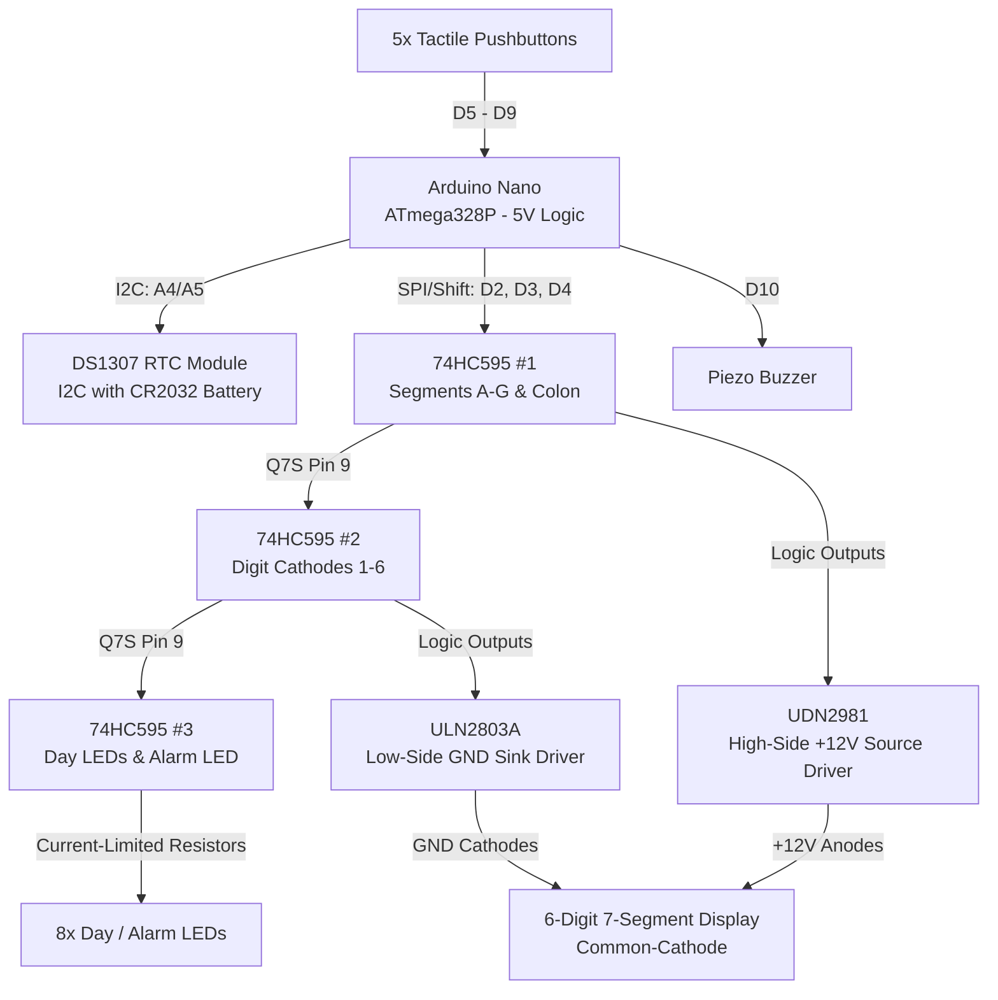
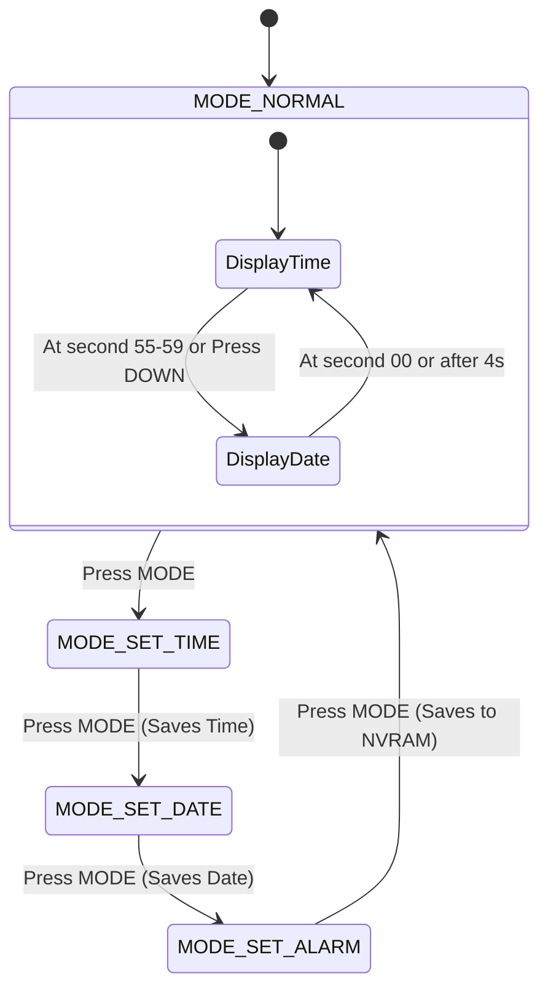

# Arduino 6-Digit 7-Segment Digital Clock

[](https://youtu.be/lr2jxXmumGY)
[](LICENSE)

A robust, high-precision **6-Digit 7-Segment Digital Clock & Calendar** built with an **Arduino Nano (ATmega328P)**, **3x 74HC595** shift registers, a high-voltage drive stage (**UDN2981** high-side source driver + **ULN2803A** low-side sink driver), and a **DS1307 I2C Real-Time Clock (RTC)**.

Designed specifically for driving large custom LED displays (such as 4 discrete LEDs in series per segment with a +12V supply), featuring full date and day-of-week indicators, programmable alarm, non-volatile memory persistence, and smooth, flicker-free multiplexing.

---

## 📺 Project Demo Video

Click the banner below to watch the live video demonstration on YouTube:

[](https://www.youtube.com/watch?v=lr2jxXmumGY)

> 🔗 **Direct Link:** [Watch the Demonstration on YouTube](https://youtu.be/lr2jxXmumGY)

---

## 🌟 Features

* **6 Full Display Digits:** Displays Hours, Minutes, and Seconds (`HH : MM : SS`).
* **Flashing Dual Colons:** 1 Hz synchronized ticking colon indicators.
* **8 Status Indicators (U3):**
  * 7 Day-of-the-week LEDs (Sunday through Saturday).
  * 1 Dedicated Alarm Status LED.
* **Automatic Periodic Calendar View:** 
  * Displays time (`HH : MM : SS`) for 55 seconds.
  * Automatically switches to date (`DD  MM  YY`) for the final 5 seconds of every minute (seconds 55–59), then transitions seamlessly back to the new minute.
  * On-demand date peek by pressing the **DOWN** button at any time.
* **Programmable Alarm with NVRAM Memory:**
  * Configurable alarm time saved directly into the DS1307's internal battery-backed NVRAM (survives main power loss).
  * Pulsed active buzzer alert pattern with single-press silence capability.
* **High-Voltage (+12V) Drive Architecture:**
  * **UDN2981 / TD62783:** High-side source driver (+12V supply for multi-LED series segments).
  * **ULN2803A:** Low-side Darlington sink driver (handles cathode multiplexing for all 6 digits).
* **Flicker-Free Multiplexing:**
  * Tailored ~67 Hz refresh rate ($2.5\,\text{ms}$ ON-time per digit) with microsecond latching to eliminate ghosting and strobing.
* **Fail-Safe Timekeeping:**
  * Autonomous internal software clock keeps ticking even if the RTC module communication is interrupted.

---

## 📐 System Architecture



---

## 🔌 Hardware Pinout & Wiring

### 1. Arduino Nano to Shift Registers (3x 74HC595)

| Arduino Nano Pin | 74HC595 Pin | Signal Name | Description |
| :--- | :--- | :--- | :--- |
| **D2** | Pin 14 (U1 only) | **DS / SER** | Serial Data Input |
| **D3** | Pin 11 (U1, U2, U3) | **SH_CP / SRCLK** | Shift Register Clock (Shared) |
| **D4** | Pin 12 (U1, U2, U3) | **ST_CP / RCLK** | Storage Latch Clock (Shared) |
| **GND** | Pin 13 (U1, U2, U3) | **OE (Active LOW)** | Solder directly to GND for 100% brightness |
| **+5V** | Pin 16 & Pin 10 (U1, U2, U3) | **VCC & MR** | Power and Master Reset (Tie MR to +5V) |
| **GND** | Pin 8 (U1, U2, U3) | **GND** | Ground reference |

*Daisy-chain connections:*
* `U1 Pin 9 (Q7S)` $\rightarrow$ `U2 Pin 14 (DS)`
* `U2 Pin 9 (Q7S)` $\rightarrow$ `U3 Pin 14 (DS)`

---

### 2. Driver Stages

#### A. Segment Anode Driver — UDN2981 (+12V High-Side from U1)
* **Pin 9 (VS):** Connected to **+12V DC**.
* **Pin 10 (GND):** Connected to **GND**.
* **Inputs (Pins 1–7):** From `U1 Q0–Q6` $\rightarrow$ **Outputs (Pins 18–12):** Via $120\,\Omega\text{--}150\,\Omega$ resistors to **Segments A through G** (paralleled to all 6 digits).
* **Input (Pin 8):** From `U1 Q7` $\rightarrow$ **Output (Pin 11):** Via resistor to **Both Center Colons**.

#### B. Digit Cathode Driver — ULN2803A (Low-Side Sink from U2)
* **Pin 9 (GND):** Connected to **GND**.
* **Pin 10 (COM):** Left unconnected / NC.
* **Inputs (Pins 1–6):** From `U2 Q0–Q5` $\rightarrow$ **Outputs (Pins 18–13):** Connected directly to **Common Cathodes of Digits 1 to 6**.

#### C. Day & Alarm Indicators (Direct drive from U3)
* `U3 Q0` to `Q6` $\rightarrow$ $330\,\Omega$ resistor $\rightarrow$ Anode of LEDs (**Sunday through Saturday**).
* `U3 Q7` $\rightarrow$ $330\,\Omega$ resistor $\rightarrow$ Anode of **Alarm Status LED**.
* All indicator LED cathodes connected to common GND.

---

### 3. Pushbuttons & Peripherals

| Arduino Nano Pin | Peripheral | Configuration |
| :--- | :--- | :--- |
| **A4** | DS1307 RTC SDA | Hardware I2C Data line |
| **A5** | DS1307 RTC SCL | Hardware I2C Clock line |
| **D5** | **MODE** Button | Momentary Tactile switch to GND (`INPUT_PULLUP`) |
| **D6** | **SET** Button | Momentary Tactile switch to GND (`INPUT_PULLUP`) |
| **D7** | **UP (+)** Button | Momentary Tactile switch to GND (`INPUT_PULLUP`) |
| **D8** | **DOWN (-)** Button | Momentary Tactile switch to GND (`INPUT_PULLUP`) |
| **D9** | **DIMMER** Button | Momentary Tactile switch to GND (`INPUT_PULLUP`) |
| **D10** | Active Buzzer | Driven via NPN transistor (or active buzzer to GND) |
| **D11** | Dimmer Mode LED | Anode via $330\,\Omega$ to GND |
| **D13** | Onboard LED | System heartbeat (blinks once per second) |

---

## 🎮 Button Operations & Menu Navigation



### 1. Normal Mode
* **Time Display:** Displays `HH : MM : SS`.
* **Date Display:** Displays `DD  MM  YY` for 5 seconds at the end of each minute, or on-demand when pressing **DOWN (-)**.
* **Press UP (+):** Toggles the Alarm ON or OFF (shows `AL on` or `AL oF` briefly; updates the Alarm LED indicator).
* **Press DOWN (-):** Peeks at the date for 4 seconds.
* **Silencing Alarm:** When the alarm is sounding, press **any button** to dismiss the buzzer.

### 2. Time Setting Mode (`MODE_SET_TIME`)
* Entered by pressing **MODE** once from normal operation.
* The selected field (**Hours** or **Minutes**) blinks.
* Press **SET** to toggle between adjusting Hours and Minutes.
* Press **UP (+)** / **DOWN (-)** to increment or decrement the value (supports holding for rapid adjustment).
* Press **MODE** to save time to RTC and proceed to Date Setting.

### 3. Date Setting Mode (`MODE_SET_DATE`)
* The active field (**Day**, **Month**, or **Year**) blinks.
* Press **SET** to cycle through Day $\rightarrow$ Month $\rightarrow$ Year.
* Press **UP (+)** / **DOWN (-)** to adjust. Includes automatic leap year and days-per-month clamping.
* Press **MODE** to save date and proceed to Alarm Setting.

### 4. Alarm Setting Mode (`MODE_SET_ALARM`)
* Digits 1 & 2 display `AL`. Digits 3 & 4 show the Alarm Hour, and Digits 5 & 6 show the Alarm Minute.
* Press **SET** to switch between Hour and Minute fields.
* Press **UP (+)** / **DOWN (-)** to adjust.
* Press **MODE** to save the new alarm time into the DS1307's NVRAM and return to Normal Mode.

---

## 💻 Installation & Getting Started

### 1. Requirements
* [Arduino IDE](https://www.arduino.cc/en/software) (Version 1.8.x or 2.x).
* **Required Dependency:**
  * `RTClib` by Adafruit (Install via `Sketch` $\rightarrow$ `Include Library` $\rightarrow$ `Manage Libraries...` $\rightarrow$ Search for **RTClib**).

---

### 2. Installing as an Arduino Library
This repository follows the standard **Arduino 1.5+ Library Specification**:

1. Click **Code** $\rightarrow$ **Download ZIP** on this GitHub repository.
2. In the Arduino IDE, navigate to:
   `Sketch` $\rightarrow$ `Include Library` $\rightarrow$ `Add .ZIP Library...`
3. Select the downloaded ZIP file.
4. You can now access the example sketches directly from:
   `File` $\rightarrow$ `Examples` $\rightarrow$ `SevenSegmentClock595` $\rightarrow$ `ClockWithAlarm`.

---

### 3. Quick Start (Minimal Code Example)

With all the low-level logic cleanly encapsulated in the `SevenSegmentClock595` library, your `.ino` sketch is just a few lines:

```cpp
#include <SevenSegmentClock595.h>

SevenSegmentClock595 myClock;

void setup() {
    // 1. Initialize with Data (D2), Clock (D3), Latch (D4), Buzzer (D10), Dimmer LED (D11)
    myClock.begin(2, 3, 4, 10, 11);

    // 2. Configure pushbutton pins: Mode (D5), Set (D6), Up (D7), Down (D8), Dimmer (D9)
    myClock.setButtons(5, 6, 7, 8, 9);
}

void loop() {
    // Handles display multiplexing, timekeeping, calendar cycle, buttons, and alarm
    myClock.update();
}
```

---

## 📚 Library API Reference

| Method | Description |
| :--- | :--- |
| `begin(dataPin, clockPin, latchPin, buzzerPin, dimmerLedPin)` | Initializes shift register pins, buzzer, dimmer LED, and RTC communication. |
| `setButtons(btnMode, btnSet, btnUp, btnDown, btnDimmer)` | Configures the 5 control pushbuttons (`INPUT_PULLUP`). |
| `update()` | **Must be called continuously in `loop()`**. Drives multiplexing, time, alarm, and buttons. |
| `setTime(hour, min, sec)` | Manually sets time and writes to RTC. |
| `setDate(day, month, year, dayOfWeek)` | Manually sets calendar date and writes to RTC. |
| `setAlarm(hour, min, enabled)` | Configures alarm time and enables/disables it in NVRAM. |
| `silenceAlarm()` | Stops active alarm buzzer. |
| `showText("HELLO ")` | Displays custom 6-character alphanumeric text across the digits. |
| `setColon(bool active)` | Controls twin colon LEDs directly. |
| `setDayIndicator(uint8_t dayIndex)` | Lights up specific day LED (0=Sun, 1=Mon, ..., 6=Sat). |
| `setAlarmIndicator(bool state)` | Controls the U3 alarm status indicator LED. |
| `setDateDisplayDuration(int seconds)` | Sets how many seconds the date is displayed at the end of each minute (default: `5`). |
| `setMuxInterval(unsigned long us)` | Sets digit multiplexing period in microseconds (default: `2500` µs). |

---

## ⚙️ Customization

| Constant / Variable | File Location | Default | Description |
| :--- | :--- | :--- | :--- |
| `MUX_INTERVAL_US` | Line 108 | `2500` | Multiplexing interval per digit in microseconds ($2.5\,\text{ms}$). Increase for higher duty cycle; decrease to increase refresh rate. |
| `DATE_DISPLAY_DURATION` | Line 125 | `5` | Duration (in seconds) for which the date is shown at the end of each minute (e.g. 5 seconds = seconds 55 to 59). |

---

## 📄 License

This project is open-source and released under the [MIT License](LICENSE). Feel free to use, modify, and distribute for personal or commercial projects.

